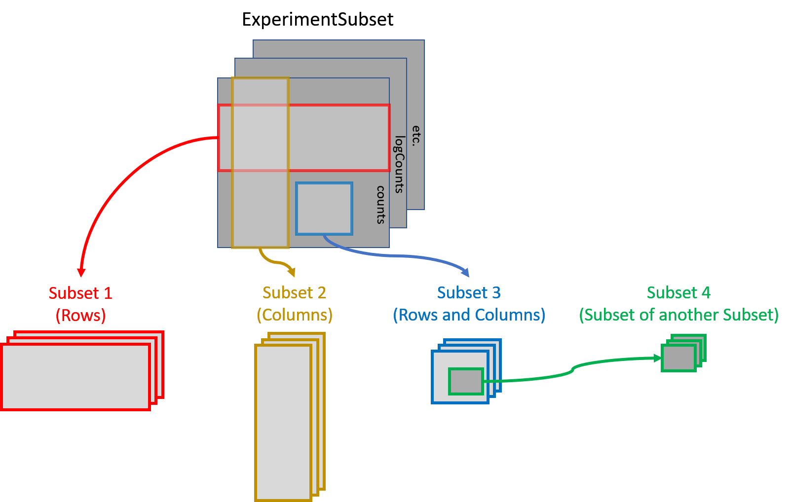

# ExperimentSubset: Manages Subsets of Data with Bioconductor Experiment Objects

This vignette is a short introduction. The [ExperimentSubset
website](https://campbio.github.io/ExperimentSubset/) has the full
reference and longer articles, including an [end-to-end single-cell
workflow](https://campbio.github.io/ExperimentSubset/dev/articles/pbmc-workflow.html)
that keeps every subset of a PBMC data set, from empty droplets to
T-cell subtypes, in one object.

## Installation

\
`if`` ``(``!`[`requireNamespace`](https://rdrr.io/r/base/ns-load.html)`(``"BiocManager"``, quietly``=``TRUE``)``)``{`\
`    `[`install.packages`](https://rdrr.io/r/utils/install.packages.html)`(``"BiocManager"``)``}`\
`BiocManager``::`[`install`](https://bioconductor.github.io/BiocManager/reference/install.html)`(``"ExperimentSubset"``)`

To install the latest version from GitHub, use the following code:

\
`BiocManager``::`[`install`](https://bioconductor.github.io/BiocManager/reference/install.html)`(``"campbio/ExperimentSubset"``)`

Loading the package:

\
[`library`](https://rdrr.io/r/base/library.html)`(`[`ExperimentSubset`](https://campbio.github.io/ExperimentSubset/)`)`

## Motivation

Experiment objects such as the `SummarizedExperiment` or
`SingleCellExperiment` are data containers for one or more matrix-like
assays along with the associated row and column data. Often only a
subset of the original data is needed for down-stream analysis. For
example, filtering out poor quality samples will require excluding some
columns before analysis. The `ExperimentSubset` object is a container to
efficiently manage different subsets of the same data without having to
make separate objects for each new subset and can be used as a drop-in
replacement for other experiment classes.

## A Brief Description

`ExperimentSubset` package enables users to perform flexible subsetting
of Single-Cell data that comes from the same experiment as well as the
consequent storage of these subsets back into the same object. In
general, it offers the same interface to the users as the
`SingleCellExperiment` container which is one the most widely used
containers for Single-Cell data. However, in addition to the features
offered by `SingleCellExperiment` container, `ExperimentSubset` offers
subsetting features while hiding the implementation details from the
users. It does so by creating references to the subset `rows` and
`columns` instead of storing a new assay whenever possible instead of
actually copying the redundant data. Functions from
`SingleCellExperiment` such as `assay`, `rowData` and `colData` can be
used for regular assays as one would normally do, as well as with newly
created subsets of the data. Most code written for the input object also
works on the `ExperimentSubset` object, and subsets are reached through
an extra `subsetName` argument and the subset methods described below.
Subsetting an object that contains subsets with `[` is not supported
yet.

## Overview of the `ExperimentSubset` class

The `ExperimentSubset` package is composed of multiple classes that
support subsets management capability depending upon the class of the
input experiment object. The currently supported experiment classes
which can be used with `ExperimentSubset` are `SummarizedExperiment`,
`RangedSummarizedExperiment`, `SingleCellExperiment`,
`TreeSummarizedExperiment` and `SpatialExperiment`.

The `ExperimentSubset` package adds an additional slot `subsets` to the
objects from these classes which enables support for the creation and
management of subsets of data.

Each subset inside the `ExperimentSubset` object (more specifically
inside the `subsets` slot of the object) is stored as an `AssaySubset`
instance. This `AssaySubset` instance creates reference to the row and
column indices for this particular subset against a parent (which can be
the inherited parent object or another subset). In case a new assay is
to be stored against a subset, it is stored as a separate experiment
object (same class as the inherited object) inside the subset.

## Core methods of `ExperimentSubset` class

Many methods of the `SummarizedExperiment` and `SingleCellExperiment`
classes accept an additional `subsetName` argument to work on a subset,
as described in the section on overridden methods below. In addition,
some core methods for the creation and manipulation of subsets are
provided with the `ExperimentSubset` class.

### `ExperimentSubset` constructor

The constructor method allows the creation of an `ExperimentSubset`
object from an input experiment object of one of the five supported
classes listed above. Additionally, if needed, a subset can be directly
created from within the constructor by providing input a named list to
the `subset` parameter.

\
`#set a seed so the random counts below are reproducible`\
[`set.seed`](https://rdrr.io/r/base/Random.html)`(``1``)`\
`counts`` ``<-`` `[`matrix`](https://rdrr.io/r/base/matrix.html)`(`[`rpois`](https://rdrr.io/r/stats/Poisson.html)`(``100``, lambda ``=`` ``10``)``, ncol``=``10``, nrow``=``10``)`\
`sce`` ``<-`` `[`SingleCellExperiment`](https://rdrr.io/pkg/SingleCellExperiment/man/SingleCellExperiment.html)`(`[`list`](https://rdrr.io/r/base/list.html)`(``counts ``=`` ``counts``)``)`\
`es`` ``<-`` `[`ExperimentSubset`](https://campbio.github.io/ExperimentSubset/dev/reference/ExperimentSubset.md)`(``sce``)`\
`es`

    ## class: SubsetSingleCellExperiment 
    ## dim: 10 10 
    ## metadata(0):
    ## assays(1): counts
    ## rownames: NULL
    ## rowData names(0):
    ## colnames: NULL
    ## colData names(0):
    ## reducedDimNames(0):
    ## mainExpName: NULL
    ## altExpNames(0):
    ## subsets(0): 
    ## subsetAssays(0):

Additionally, an `ExperimentSubset` object can also be created directly
from generally loaded data such as counts matrices, which can be passed
to the constructor function in a list.

\
`counts`` ``<-`` `[`matrix`](https://rdrr.io/r/base/matrix.html)`(`[`rpois`](https://rdrr.io/r/stats/Poisson.html)`(``100``, lambda ``=`` ``10``)``, ncol``=``10``, nrow``=``10``)`\
[`ExperimentSubset`](https://campbio.github.io/ExperimentSubset/dev/reference/ExperimentSubset.md)`(`[`list`](https://rdrr.io/r/base/list.html)`(``counts ``=`` ``counts``)``)`

    ## class: SubsetSingleCellExperiment 
    ## dim: 10 10 
    ## metadata(0):
    ## assays(1): counts
    ## rownames: NULL
    ## rowData names(0):
    ## colnames: NULL
    ## colData names(0):
    ## reducedDimNames(0):
    ## mainExpName: NULL
    ## altExpNames(0):
    ## subsets(0): 
    ## subsetAssays(0):

### `createSubset`

The `createSubset` method as evident from the name, creates a subset
from an already available `assay` in the object. The `subsetName` (a
`character` string), `rows` (a `numeric` or `character` `vector`),
`cols` (a `numeric` or `character` `vector`) and `parentAssay` (a
`character` string) are the standard parameters of the `createSubset`
method. If `rows` or `cols` are `missing` or `NULL`, all of the rows or
columns are selected from the specified `parentAssay`. If `parentAssay`
is `missing` or `NULL`, the first available assay from the parent object
is linked as the parent of this subset. The `parentAssay` can be an
`assay` in the parent object, a subset, or an `assay` seen in a subset,
written as `"subset/assay"`.

\
`es`` ``<-`` `[`createSubset`](https://campbio.github.io/ExperimentSubset/dev/reference/createSubset.md)`(``es``, `\
`                   subsetName ``=`` ``"subset1"``,`\
`                   rows ``=`` `[`c`](https://rdrr.io/r/base/c.html)`(``1``:``2``)``,`\
`                   cols ``=`` `[`c`](https://rdrr.io/r/base/c.html)`(``1``:``5``)``,`\
`                   parentAssay ``=`` ``"counts"``)`\
`es`

    ## class: SubsetSingleCellExperiment 
    ## dim: 10 10 
    ## metadata(0):
    ## assays(1): counts
    ## rownames: NULL
    ## rowData names(0):
    ## colnames: NULL
    ## colData names(0):
    ## reducedDimNames(0):
    ## mainExpName: NULL
    ## altExpNames(0):
    ## subsets(1): subset1
    ## subsetAssays(1): subset1

### `setSubsetAssay` and `getSubsetAssay`

The `setSubsetAssay` method should be used when a subset `assay` needs
to be stored in a previously created subset. This is specifically
different from the `createSubset` method which only creates a subset by
referencing to a defined `parentAssay` where the `internalAssay` of the
subset has no assays stored. The `setSubsetAssay` method however, is
used to store an `assay` in this `internalAssay` slot of the subset
which in fact is a subset experiment object of the same class as the
parent object.

\
`subset1Assay`` ``<-`` `[`assay`](https://rdrr.io/pkg/SummarizedExperiment/man/SummarizedExperiment-class.html)`(``es``, ``"subset1"``)`\
`subset1Assay``[``,``]`` ``<-`` ``subset1Assay``[``,``]`` ``+`` ``1`\
`es`` ``<-`` `[`setSubsetAssay`](https://campbio.github.io/ExperimentSubset/dev/reference/setSubsetAssay.md)`(``es``, `\
`                  subsetName ``=`` ``"subset1"``, `\
`                  inputMatrix ``=`` ``subset1Assay``, `\
`                  subsetAssayName ``=`` ``"subset1Assay"``)`\
`es`

    ## class: SubsetSingleCellExperiment 
    ## dim: 10 10 
    ## metadata(0):
    ## assays(1): counts
    ## rownames: NULL
    ## rowData names(0):
    ## colnames: NULL
    ## colData names(0):
    ## reducedDimNames(0):
    ## mainExpName: NULL
    ## altExpNames(0):
    ## subsets(1): subset1
    ## subsetAssays(2): subset1 subset1/subset1Assay

The parameters of interest against this method are `subsetName` which
specifies the name of the subset inside which the an input assay should
be stored, `inputMatrix` which is a matrix-type object to be stored as
an assay inside a subset specified by the `subsetName` parameter and
lastly the `subsetAssayName` parameter which represents the name of the
new assay.

To get a subset assay, `getSubsetAssay` method can be used:

\
`#get assay from 'subset1'`\
[`getSubsetAssay`](https://campbio.github.io/ExperimentSubset/dev/reference/getSubsetAssay.md)`(``es``, subsetName ``=`` ``"subset1"``)`

    ##      [,1] [,2] [,3] [,4] [,5]
    ## [1,]    8    8    3    5    5
    ## [2,]   10    2   11   13   12

\
`#get 'subset1Assay', stored inside 'subset1'`\
[`getSubsetAssay`](https://campbio.github.io/ExperimentSubset/dev/reference/getSubsetAssay.md)`(``es``, subsetName ``=`` ``"subset1"``, subsetAssayName ``=`` ``"subset1Assay"``)`

    ##      [,1] [,2] [,3] [,4] [,5]
    ## [1,]    9    9    4    6    6
    ## [2,]   11    3   12   14   13

\
`#the same assay, named as "subset/assay"`\
[`getSubsetAssay`](https://campbio.github.io/ExperimentSubset/dev/reference/getSubsetAssay.md)`(``es``, subsetName ``=`` ``"subset1/subset1Assay"``)`

    ##      [,1] [,2] [,3] [,4] [,5]
    ## [1,]    9    9    4    6    6
    ## [2,]   11    3   12   14   13

A subset also sees the assays of its parent, sliced to its rows and
columns, under the same names: these are *linked* assays, and they are
not copied. Each subset has its own names, so two subsets made from the
same parent can store an assay with the same name. Storing an assay with
a name the subset already sees through its parent needs `unlink = TRUE`,
which makes the subset (and subsets made from it) use its own version
from then on.

\
`#'subset1' sees its own assay and the main 'counts' it was made from`\
[`subsetAssayNames`](https://campbio.github.io/ExperimentSubset/dev/reference/subsetAssayNames.md)`(``es``, subsetName ``=`` ``"subset1"``)`

    ## [1] "counts"       "subset1Assay"

Apart from `setSubsetAssay` and `getSubsetAssay` methods, `assay` and
`assay<-` methods can also be used for the same purpose. Their usage has
been described in the overridden methods section below.

### `getSubsetExperiment` and `setSubsetExperiment`

`getSubsetExperiment` returns a subset as a standalone object of the
main object’s class, here a `SingleCellExperiment`, with the assays the
subset sees (its own and the linked ones), its colData, rowData,
reducedDims and metadata. Any tool written for that class can then be
run on it. `setSubsetExperiment` stores the result back in the subset:
what the object holds replaces the subset’s own data, while linked
assays that are unchanged are not copied.

\
`#take 'subset1' out as a SingleCellExperiment`\
`subset1`` ``<-`` `[`getSubsetExperiment`](https://campbio.github.io/ExperimentSubset/dev/reference/getSubsetExperiment.md)`(``es``, subsetName ``=`` ``"subset1"``)`\
`subset1`

    ## class: SingleCellExperiment 
    ## dim: 2 5 
    ## metadata(0):
    ## assays(2): counts subset1Assay
    ## rownames: NULL
    ## rowData names(0):
    ## colnames: NULL
    ## colData names(0):
    ## reducedDimNames(0):
    ## mainExpName: NULL
    ## altExpNames(0):

\
`#add a colData column and a reducedDim, as a tool might`\
`subset1``$``group`` ``<-`` `[`c`](https://rdrr.io/r/base/c.html)`(``"a"``, ``"a"``, ``"b"``, ``"b"``, ``"b"``)`\
[`reducedDim`](https://rdrr.io/pkg/SingleCellExperiment/man/reducedDims.html)`(``subset1``, ``"example"``)`` ``<-`` `[`matrix`](https://rdrr.io/r/base/matrix.html)`(``1``:``10``, nrow ``=`` ``5``)`\
\
`#store them back in 'subset1'`\
`es`` ``<-`` `[`setSubsetExperiment`](https://campbio.github.io/ExperimentSubset/dev/reference/setSubsetExperiment.md)`(``es``, subsetName ``=`` ``"subset1"``, value ``=`` ``subset1``)`\
[`colData`](https://rdrr.io/pkg/SummarizedExperiment/man/SummarizedExperiment-class.html)`(``es``, subsetName ``=`` ``"subset1"``)`

    ## DataFrame with 5 rows and 1 column
    ##         group
    ##   <character>
    ## 1           a
    ## 2           a
    ## 3           b
    ## 4           b
    ## 5           b

\
[`reducedDimNames`](https://campbio.github.io/ExperimentSubset/dev/reference/reducedDimNames.md)`(``es``, subsetName ``=`` ``"subset1"``)`

    ## [1] "example"

### `subsetSummary`

The `subsetSummary` method displays an overall summary of the
`ExperimentSubset` object including the assays in the parent object, the
list of subsets along with the stored assays, reduced dimensions, alt
experiments and other supplementary information that may help the users
understand the current condition of the object. The most important piece
of information displayed by this method is the hierarchical
‘parent-subset’ link against each subset in the object.

\
[`subsetSummary`](https://campbio.github.io/ExperimentSubset/dev/reference/subsetSummary.md)`(``es``)`

    ## Main assay(s):
    ##  counts 
    ## 
    ## Subset(s):
    ##      Name  Dim Parent       Assays ReducedDims
    ## 1 subset1 2, 5 counts subset1Assay     example

### Additional helper methods

Helper methods have been provided for use by the users during specific
circumstances while manipulating subsets of data. These helper methods
and their short descriptions are given below:

1.  `subsetNames` Returns the names of all available subsets (excluding
    internal subset assays)
2.  `subsetAssayNames` Returns the names of all available subsets
    (including internal subset assays)
3.  `subsetCount` Returns the total count of the subsets (excluding
    internal subset assays)
4.  `subsetAssayCount` Returns the total count of the subsets (including
    internal subset assays)
5.  `subsetDim` Returns the dimensions of a specified subset
6.  `subsetColData` Gets or sets colData from/to a subset
7.  `subsetRowData` Gets or sets rowData from/to a subset
8.  `subsetColnames` Gets or sets colnames from/to a subset
9.  `subsetRownames` Gets or sets rownames from/to a subset
10. `subsetParent` Returns the ‘subset-parent’ link of a specified
    subset
11. `setSubsetAssay` Sets an assay to a subset
12. `getSubsetAssay` Gets an assay from a subset
13. `getSubsetExperiment` Returns a subset as a standalone experiment
    object
14. `setSubsetExperiment` Stores a standalone experiment object in a
    subset

#### subsetColData & subsetRowData

Both `subsetColData` and `subsetRowData` getter methods take in an
additional logical parameter `parentColData` or `parentRowData` that
specifies if the returned ‘colData’ or ‘rowData’ should include the
‘colData’ and ‘rowData’ from the parent object as well. By default,
`parentColData` and `parentRowData` parameters are set to `FALSE`. Same
applies to the usage of inherited `rowData` and `colData` methods.

\
`#number of columns in 'subset1'`\
`subset1Columns`` ``<-`` `[`subsetDim`](https://campbio.github.io/ExperimentSubset/dev/reference/subsetDim.md)`(``es``, subsetName ``=`` ``"subset1"``)``[``2``]`\
\
`#store a colData column in the parent object`\
[`colData`](https://rdrr.io/pkg/SummarizedExperiment/man/SummarizedExperiment-class.html)`(``es``)``$``sampleID`` ``<-`` `[`seq_len`](https://rdrr.io/r/base/seq.html)`(`[`ncol`](https://rdrr.io/r/base/nrow.html)`(``es``)``)`\
\
`#store a colData column in 'subset1' using option 1`\
[`colData`](https://rdrr.io/pkg/SummarizedExperiment/man/SummarizedExperiment-class.html)`(``es``, subsetName ``=`` ``"subset1"``)``$``subsetSampleID1`` ``<-`` `[`seq_len`](https://rdrr.io/r/base/seq.html)`(``subset1Columns``)`\
\
`#store a colData column in 'subset1' using option 2`\
[`subsetColData`](https://campbio.github.io/ExperimentSubset/dev/reference/subsetColData.md)`(``es``, subsetName ``=`` ``"subset1"``)``$``subsetSampleID2`` ``<-`\
`  `[`seq_len`](https://rdrr.io/r/base/seq.html)`(``subset1Columns``)`\
\
`#get colData from 'subset1' without parent colData`\
[`subsetColData`](https://campbio.github.io/ExperimentSubset/dev/reference/subsetColData.md)`(``es``, subsetName ``=`` ``"subset1"``, parentColData ``=`` ``FALSE``)`

    ## DataFrame with 5 rows and 3 columns
    ##         group subsetSampleID1 subsetSampleID2
    ##   <character>       <integer>       <integer>
    ## 1           a               1               1
    ## 2           a               2               2
    ## 3           b               3               3
    ## 4           b               4               4
    ## 5           b               5               5

\
`#get colData from 'subset1' with parent colData`\
[`subsetColData`](https://campbio.github.io/ExperimentSubset/dev/reference/subsetColData.md)`(``es``, subsetName ``=`` ``"subset1"``, parentColData ``=`` ``TRUE``)`

    ## DataFrame with 5 rows and 4 columns
    ##    sampleID       group subsetSampleID1 subsetSampleID2
    ##   <integer> <character>       <integer>       <integer>
    ## 1         1           a               1               1
    ## 2         2           a               2               2
    ## 3         3           b               3               3
    ## 4         4           b               4               4
    ## 5         5           b               5               5

\
`` #the same works with the `colData` method (and with `rowData` and the ``\
`` #`parentRowData` parameter for row data) ``\
[`colData`](https://rdrr.io/pkg/SummarizedExperiment/man/SummarizedExperiment-class.html)`(``es``, subsetName ``=`` ``"subset1"``, parentColData ``=`` ``FALSE``)`` ``#without parent data`

    ## DataFrame with 5 rows and 3 columns
    ##         group subsetSampleID1 subsetSampleID2
    ##   <character>       <integer>       <integer>
    ## 1           a               1               1
    ## 2           a               2               2
    ## 3           b               3               3
    ## 4           b               4               4
    ## 5           b               5               5

\
[`colData`](https://rdrr.io/pkg/SummarizedExperiment/man/SummarizedExperiment-class.html)`(``es``, subsetName ``=`` ``"subset1"``, parentColData ``=`` ``TRUE``)`` ``#with parent data`

    ## DataFrame with 5 rows and 4 columns
    ##    sampleID       group subsetSampleID1 subsetSampleID2
    ##   <integer> <character>       <integer>       <integer>
    ## 1         1           a               1               1
    ## 2         2           a               2               2
    ## 3         3           b               3               3
    ## 4         4           b               4               4
    ## 5         5           b               5               5

### Overridden methods for `ExperimentSubset` class

These are the methods that have been overridden from other classes to
support the subset feature of the `ExperimentSubset` objects by
introducing an additional parameter `subsetName` to these methods. These
methods can simply be called on any `ExperimentSubset` object to get or
set from the parent object or from any subset by passing the optional
`subsetName` parameter.

The methods include `rowData`, `rowData<-`, `colData`, `colData<-`,
`metadata`, `metadata<-`, `reducedDim`, `reducedDim<-`, `reducedDims`,
`reducedDims<-`, `reducedDimNames`, `reducedDimNames<-`, `altExp`,
`altExp<-`, `altExps`, `altExps<-`, `altExpNames` and `altExpNames<-`,
and for `SpatialExperiment` objects `spatialCoords` and `spatialData`.
All of these methods can be used with the subsets by providing the
optional `subsetName` parameter.

#### assay-get & assay-set inherited methods

An exception to the above approach is the use of `assay` and `assay<-`
methods, both of which have a slightly different usage as described
below:

Because the `assay<-` setter method in the case of a subset needs to
store the assay inside the subset, we need to specify the subset name
inside which the assay should be stored as `i` parameter and define the
new name of the subset assay as the additional `subsetAssayName`
parameter.

\
`#creating a dummy ES object`\
`counts`` ``<-`` `[`matrix`](https://rdrr.io/r/base/matrix.html)`(`[`rpois`](https://rdrr.io/r/stats/Poisson.html)`(``100``, lambda ``=`` ``10``)``, ncol``=``10``, nrow``=``10``)`\
`sce`` ``<-`` `[`SingleCellExperiment`](https://rdrr.io/pkg/SingleCellExperiment/man/SingleCellExperiment.html)`(`[`list`](https://rdrr.io/r/base/list.html)`(``counts ``=`` ``counts``)``)`\
`es`` ``<-`` `[`ExperimentSubset`](https://campbio.github.io/ExperimentSubset/dev/reference/ExperimentSubset.md)`(``sce``)`\
\
`#create a subset`\
`es`` ``<-`` `[`createSubset`](https://campbio.github.io/ExperimentSubset/dev/reference/createSubset.md)`(``es``, subsetName ``=`` ``"subset1"``, rows ``=`` `[`c`](https://rdrr.io/r/base/c.html)`(``1``:``2``)``, cols ``=`` `[`c`](https://rdrr.io/r/base/c.html)`(``1``:``4``)``)`\
\
`#store an assay inside the newly created 'subset1'`\
`#note that 'assay<-' setter has two important parameters 'x' and 'i' where`\
`#'x' is the object and 'i' is the assay name, but in the case of storing to a`\
`#subset we use 'x' as the object, 'i' as the subset name inside which the assay`\
`#should be stored and an additional 'subsetAssayName' parameter which defines`\
`#the name of the new assay`\
[`assay`](https://rdrr.io/pkg/SummarizedExperiment/man/SummarizedExperiment-class.html)`(`\
`  x ``=`` ``es``, `\
`  i ``=`` ``"subset1"``, `\
`  subsetAssayName ``=`` ``"subset1InternalAssay"``)`` ``<-`` `[`matrix`](https://rdrr.io/r/base/matrix.html)`(`[`rpois`](https://rdrr.io/r/stats/Poisson.html)`(``8``, lambda ``=`` ``10``)``, `\
`                                                      ncol``=``4``, nrow``=``2``)`

Using `assay` getter method is simple, as no additional parameter is
required unlike in the setter method.

\
`#assay getter has parameters 'x' which is the input object and 'i' which can`\
`#be an assay name in the parent object or a subset name; an assay inside a`\
`#subset is chosen with 'subsetAssayName' or named as "subset/assay"`\
\
`#getting 'counts' from parent es object`\
[`assay`](https://rdrr.io/pkg/SummarizedExperiment/man/SummarizedExperiment-class.html)`(`\
`  x ``=`` ``es``,`\
`  i ``=`` ``"counts"`\
`)`

    ##       [,1] [,2] [,3] [,4] [,5] [,6] [,7] [,8] [,9] [,10]
    ##  [1,]   11    8    2    6    4    8    6    7   14    12
    ##  [2,]   15    9    7    8   11   11   16   14   13    10
    ##  [3,]    9    9    8   10    8   10    9    8    9     8
    ##  [4,]    7   13   13   15   14    5    6   12    5     8
    ##  [5,]    9   10    8    8    7   11   10    8   12    12
    ##  [6,]   12   11    9    6   15    7   11    5    8     6
    ##  [7,]   13    9   12   10    9   13    6   14    5    10
    ##  [8,]   10    9   15   13    5    9    5   14   10     9
    ##  [9,]    7   12   10    2   11    9   10   12    7    14
    ## [10,]    6   13    8    9   13   12    8    4   12    10

\
`#getting just the 'subset1' from es object`\
[`assay`](https://rdrr.io/pkg/SummarizedExperiment/man/SummarizedExperiment-class.html)`(`\
`  x ``=`` ``es``,`\
`  i ``=`` ``"subset1"`\
`)`

    ##      [,1] [,2] [,3] [,4]
    ## [1,]   11    8    2    6
    ## [2,]   15    9    7    8

\
`#getting the 'subset1InternalAssay' from inside the 'subset1'`\
[`assay`](https://rdrr.io/pkg/SummarizedExperiment/man/SummarizedExperiment-class.html)`(`\
`  x ``=`` ``es``,`\
`  i ``=`` ``"subset1"``,`\
`  subsetAssayName ``=`` ``"subset1InternalAssay"`\
`)`

    ##      [,1] [,2] [,3] [,4]
    ## [1,]   10    6   12    9
    ## [2,]   10   14   11   14

## Using the `ExperimentSubset` object: A toy example

Creating the `ExperimentSubset` object is as simple as passing an
experiment object to the `ExperimentSubset` constructor:

\
`counts`` ``<-`` `[`matrix`](https://rdrr.io/r/base/matrix.html)`(`[`rpois`](https://rdrr.io/r/stats/Poisson.html)`(``100``, lambda ``=`` ``10``)``, ncol``=``10``, nrow``=``10``)`\
`sce`` ``<-`` `[`SingleCellExperiment`](https://rdrr.io/pkg/SingleCellExperiment/man/SingleCellExperiment.html)`(`[`list`](https://rdrr.io/r/base/list.html)`(``counts ``=`` ``counts``)``)`\
`es`` ``<-`` `[`ExperimentSubset`](https://campbio.github.io/ExperimentSubset/dev/reference/ExperimentSubset.md)`(``sce``)`\
[`subsetSummary`](https://campbio.github.io/ExperimentSubset/dev/reference/subsetSummary.md)`(``es``)`

    ## Main assay(s):
    ##  counts 
    ## 
    ## Subset(s):
    ## NULL

Create a subset that includes the first 5 rows and columns only:

\
`es`` ``<-`` `[`createSubset`](https://campbio.github.io/ExperimentSubset/dev/reference/createSubset.md)`(``es``, `\
`                   subsetName ``=`` ``"subset1"``,`\
`                   rows ``=`` `[`c`](https://rdrr.io/r/base/c.html)`(``1``:``5``)``,`\
`                   cols ``=`` `[`c`](https://rdrr.io/r/base/c.html)`(``1``:``5``)``,`\
`                   parentAssay ``=`` ``"counts"``)`\
[`subsetSummary`](https://campbio.github.io/ExperimentSubset/dev/reference/subsetSummary.md)`(``es``)`

    ## Main assay(s):
    ##  counts 
    ## 
    ## Subset(s):
    ##      Name  Dim Parent
    ## 1 subset1 5, 5 counts

Create another subset from `subset1` by only keeping the first two rows:

\
`es`` ``<-`` `[`createSubset`](https://campbio.github.io/ExperimentSubset/dev/reference/createSubset.md)`(``es``, `\
`                   subsetName ``=`` ``"subset2"``,`\
`                   rows ``=`` `[`c`](https://rdrr.io/r/base/c.html)`(``1``:``2``)``,`\
`                   cols ``=`` `[`c`](https://rdrr.io/r/base/c.html)`(``1``:``5``)``,`\
`                   parentAssay ``=`` ``"subset1"``)`\
[`subsetSummary`](https://campbio.github.io/ExperimentSubset/dev/reference/subsetSummary.md)`(``es``)`

    ## Main assay(s):
    ##  counts 
    ## 
    ## Subset(s):
    ##      Name  Dim            Parent
    ## 1 subset1 5, 5            counts
    ## 2 subset2 2, 5 subset1 -> counts

Get `assay` from `subset2` and update values:

\
`subset2Assay`` ``<-`` `[`assay`](https://rdrr.io/pkg/SummarizedExperiment/man/SummarizedExperiment-class.html)`(``es``, ``"subset2"``)`\
`subset2Assay``[``,``]`` ``<-`` ``subset2Assay``[``,``]`` ``+`` ``1`

Store the updated `assay` back to `subset2` using one of the two
approaches:

\
`#approach 1`\
`es`` ``<-`` `[`setSubsetAssay`](https://campbio.github.io/ExperimentSubset/dev/reference/setSubsetAssay.md)`(``es``, `\
`                  subsetName ``=`` ``"subset2"``, `\
`                  inputMatrix ``=`` ``subset2Assay``, `\
`                  subsetAssayName ``=`` ``"subset2Assay_a1"``)`\
\
`#approach 2`\
[`assay`](https://rdrr.io/pkg/SummarizedExperiment/man/SummarizedExperiment-class.html)`(``es``, ``"subset2"``, subsetAssayName ``=`` ``"subset2Assay_a2"``)`` ``<-`` ``subset2Assay`\
[`subsetSummary`](https://campbio.github.io/ExperimentSubset/dev/reference/subsetSummary.md)`(``es``)`

    ## Main assay(s):
    ##  counts 
    ## 
    ## Subset(s):
    ##      Name  Dim            Parent                           Assays
    ## 1 subset1 5, 5            counts                                 
    ## 2 subset2 2, 5 subset1 -> counts subset2Assay_a1, subset2Assay_a2

Store an experiment object in the `altExp` slot of `subset2`:

\
[`altExp`](https://rdrr.io/pkg/SingleCellExperiment/man/altExps.html)`(``x ``=`` ``es``,`\
`       e ``=`` ``"subset2_alt1"``,`\
`       subsetName ``=`` ``"subset2"``)`` ``<-`` `[`SingleCellExperiment`](https://rdrr.io/pkg/SingleCellExperiment/man/SingleCellExperiment.html)`(``assays ``=`` `[`list`](https://rdrr.io/r/base/list.html)`(`\
`         counts ``=`` `[`assay`](https://rdrr.io/pkg/SummarizedExperiment/man/SummarizedExperiment-class.html)`(``es``, ``"subset2"``)`\
`       ``)``)`

Show the current condition of `ExperimentSubset` object:

\
[`subsetSummary`](https://campbio.github.io/ExperimentSubset/dev/reference/subsetSummary.md)`(``es``)`

    ## Main assay(s):
    ##  counts 
    ## 
    ## Subset(s):
    ##      Name  Dim            Parent                           Assays
    ## 1 subset1 5, 5            counts                                 
    ## 2 subset2 2, 5 subset1 -> counts subset2Assay_a1, subset2Assay_a2
    ##   AltExperiments
    ## 1               
    ## 2   subset2_alt1

## Using the `ExperimentSubset` object: an example with real scRNA-seq data

This short example on the PBMC 4k data set isn’t run when the vignette
is built. For a complete, runnable workflow on the same data, from raw
droplets through quality control, decontamination, clustering and
annotation to a re-analysis of the T cells, see the [single-cell
workflow
article](https://campbio.github.io/ExperimentSubset/dev/articles/pbmc-workflow.html).

Installing and loading required packages:

\
`if`` ``(``!`[`requireNamespace`](https://rdrr.io/r/base/ns-load.html)`(``"BiocManager"``, quietly ``=`` ``TRUE``)``)`\
`    `[`install.packages`](https://rdrr.io/r/utils/install.packages.html)`(``"BiocManager"``)`\
`BiocManager``::`[`install`](https://bioconductor.github.io/BiocManager/reference/install.html)`(`[`c`](https://rdrr.io/r/base/c.html)`(``"TENxPBMCData"``, ``"scrapper"``)``)`

\
[`library`](https://rdrr.io/r/base/library.html)`(`[`ExperimentSubset`](https://campbio.github.io/ExperimentSubset/)`)`\
[`library`](https://rdrr.io/r/base/library.html)`(``TENxPBMCData``)`\
[`library`](https://rdrr.io/r/base/library.html)`(`[`scrapper`](https://github.com/libscran/scrapper)`)`

Load PBMC4K dataset and create `ExperimentSubset` object:

\
`tenx_pbmc4k`` ``<-`` `[`TENxPBMCData`](https://rdrr.io/pkg/TENxPBMCData/man/TENxPBMCData.html)`(``dataset ``=`` ``"pbmc4k"``)`\
`es`` ``<-`` `[`ExperimentSubset`](https://campbio.github.io/ExperimentSubset/dev/reference/ExperimentSubset.md)`(``tenx_pbmc4k``)`\
[`subsetSummary`](https://campbio.github.io/ExperimentSubset/dev/reference/subsetSummary.md)`(``es``)`

Compute per-cell QC metrics on the `counts` matrix using the `scrapper`
library and store the total count (`sum`) for each cell:

\
`qcMetrics`` ``<-`` `[`computeRnaQcMetrics`](https://rdrr.io/pkg/scrapper/man/rna_quality_control.html)`(`[`assay`](https://rdrr.io/pkg/SummarizedExperiment/man/SummarizedExperiment-class.html)`(``es``, ``"counts"``)``, subsets ``=`` `[`list`](https://rdrr.io/r/base/list.html)`(``)``)`\
[`colData`](https://rdrr.io/pkg/SummarizedExperiment/man/SummarizedExperiment-class.html)`(``es``)``$``sum`` ``<-`` ``qcMetrics``$``sum`

Filter cells with low column sum and create a new subset called
‘filteredCells’:

\
`filteredCellsIndices`` ``<-`` `[`which`](https://rdrr.io/r/base/which.html)`(`[`colData`](https://rdrr.io/pkg/SummarizedExperiment/man/SummarizedExperiment-class.html)`(``es``)``$``sum`` ``>`` ``1500``)`\
`es`` ``<-`` `[`createSubset`](https://campbio.github.io/ExperimentSubset/dev/reference/createSubset.md)`(``es``, subsetName ``=`` ``"filteredCells"``,`\
`                   cols ``=`` ``filteredCellsIndices``, parentAssay ``=`` ``"counts"``)`\
[`subsetSummary`](https://campbio.github.io/ExperimentSubset/dev/reference/subsetSummary.md)`(``es``)`

Normalize ‘filteredCells’ subset using `scrapper` library and store it
back. Size factors are computed from each cell’s total count and
centered at one:

\
`filteredCounts`` ``<-`` `[`assay`](https://rdrr.io/pkg/SummarizedExperiment/man/SummarizedExperiment-class.html)`(``es``, ``"filteredCells"``)`\
`filteredSizeFactors`` ``<-`` `[`centerSizeFactors`](https://rdrr.io/pkg/scrapper/man/centerSizeFactors.html)`(`[`colSums`](https://rdrr.io/r/base/colSums.html)`(``filteredCounts``)``)`\
`normalizedCounts`` ``<-`` `[`normalizeCounts`](https://rdrr.io/pkg/scrapper/man/normalizeCounts.html)`(``filteredCounts``,`\
`                                    size.factors ``=`` ``filteredSizeFactors``)`\
[`assay`](https://rdrr.io/pkg/SummarizedExperiment/man/SummarizedExperiment-class.html)`(``es``, ``"filteredCells"``,`\
`      subsetAssayName ``=`` ``"filteredCellsNormalized"``)`` ``<-`` ``normalizedCounts`\
[`subsetSummary`](https://campbio.github.io/ExperimentSubset/dev/reference/subsetSummary.md)`(``es``)`

Find highly variable genes from the normalized assay in the previous
step using `scrapper` library against the ‘filteredCells’ subset only:

\
`normalizedCounts`` ``<-`` `[`assay`](https://rdrr.io/pkg/SummarizedExperiment/man/SummarizedExperiment-class.html)`(``es``, ``"filteredCells/filteredCellsNormalized"``)`\
`geneVariances`` ``<-`` `[`modelGeneVariances`](https://rdrr.io/pkg/scrapper/man/modelGeneVariances.html)`(``normalizedCounts``)`\
`residualVariances`` ``<-`` ``geneVariances``$``statistics``$``residuals`\
`topHVG2000`` ``<-`` `[`chooseHighlyVariableGenes`](https://rdrr.io/pkg/scrapper/man/chooseHighlyVariableGenes.html)`(``residualVariances``, top ``=`` ``2000``)`\
`es`` ``<-`` `[`createSubset`](https://campbio.github.io/ExperimentSubset/dev/reference/createSubset.md)`(``es``, subsetName ``=`` ``"hvg2000"``, rows ``=`` ``topHVG2000``,`\
`                   parentAssay ``=`` ``"filteredCells/filteredCellsNormalized"``)`\
[`subsetSummary`](https://campbio.github.io/ExperimentSubset/dev/reference/subsetSummary.md)`(``es``)`

Run ‘PCA’ on the highly variable genes computed in the last step using
`scrapper` library against the ‘hvg2000’ subset only. `runPca` returns
the PCs in rows, so transpose them to put cells in rows:

\
`pcaResult`` ``<-`` `[`runPca`](https://rdrr.io/pkg/scrapper/man/runPca.html)`(`[`assay`](https://rdrr.io/pkg/SummarizedExperiment/man/SummarizedExperiment-class.html)`(``es``, ``"hvg2000"``)``)`\
`pcaScores`` ``<-`` `[`t`](https://rdrr.io/r/base/t.html)`(``pcaResult``$``components``)`\
[`reducedDim`](https://rdrr.io/pkg/SingleCellExperiment/man/reducedDims.html)`(``es``, type ``=`` ``"PCA"``, subsetName ``=`` ``"hvg2000"``)`` ``<-`` ``pcaScores`

Show the current condition of the `ExperimentSubset` object:

\
[`subsetSummary`](https://campbio.github.io/ExperimentSubset/dev/reference/subsetSummary.md)`(``es``)`

## Supported Input Object Classes

1.  SummarizedExperiment
2.  RangedSummarizedExperiment
3.  SingleCellExperiment
4.  TreeSummarizedExperiment
5.  SpatialExperiment

## Methods for `ExperimentSubset`

1.  `ExperimentSubset` constructor
2.  `createSubset`
3.  `setSubsetAssay`
4.  `getSubsetAssay`
5.  `getSubsetExperiment`
6.  `setSubsetExperiment`
7.  `subsetSummary`
8.  `subsetParent`
9.  `subsetCount`
10. `subsetAssayCount`
11. `subsetNames`
12. `subsetAssayNames`
13. `subsetDim`
14. `subsetRowData`
15. `subsetColData`
16. `subsetColnames`
17. `subsetRownames`
18. `subsetRowData<-`
19. `subsetColData<-`
20. `subsetColnames<-`
21. `subsetRownames<-`
22. `show`
23. `assay`
24. `assay<-`
25. `rowData`
26. `rowData<-`
27. `colData`
28. `colData<-`
29. `metadata`
30. `metadata<-`
31. `reducedDim`
32. `reducedDim<-`
33. `reducedDims`
34. `reducedDims<-`
35. `reducedDimNames`
36. `reducedDimNames<-`
37. `altExp`
38. `altExp<-`
39. `altExps`
40. `altExps<-`
41. `altExpNames`
42. `altExpNames<-`
43. `subsetSpatialCoords`
44. `subsetSpatialData`
45. `subsetSpatialData<-`
46. `subsetRowLinks`
47. `subsetColLinks`
48. `spatialCoords`
49. `spatialData`
50. `spatialData<-`
51. `rowLinks`
52. `colLinks`

## Implementation Details

The internal structure of an `ExperimentSubset` class is described
below:

### Inherited parent object

The `ExperimentSubset` object during creation is assigned one of the
classes `SubsetSummarizedExperiment`,
`SubsetRangedSummarizedExperiment`, `SubsetSingleCellExperiment`,
`SubsetTreeSummarizedExperiment` or `SubsetSpatialExperiment`, each of
which inherits from the class of the input object. This ensures that
`ExperimentSubset` object can be manipulated in a fashion similar to the
input object class and so can be used as a drop-in replacement for these
classes. Most methods that work on the input object class work on the
`ExperimentSubset` objects as well; subsetting with `[` is an exception
for objects that contain subsets.

### Additional `subsets` slot

The `subsets` slot of the `ExperimentSubset` object is a `SimpleList`,
where each element in this list is an object of an internal
`AssaySubset` class. The slot itself is not directly accessible to the
users and should be accessed through the provided methods of the
`ExperimentSubset` package. Each element represents one subset linked to
the experiment object in the parent object. The structure of each subset
is described below:

#### `subsetName`

A `character` string that represents a user-defined name of the subset.

#### `rowIndices`

A `numeric` `vector` that stores the indices of the selected rows in the
linked parent assay within for this subset.

#### `colIndices`

A `numeric` `vector` that stores the indices of the selected columns in
the linked parent assay for this subset.

#### `parentAssay`

A `character` string that stores the name of the immediate parent to
which the subset is linked. The `parentAssay` can be an `assay` in the
parent `ExperimentSubset` object, any subset, or an assay seen in a
subset written as `"subset/assay"`.

#### `internalAssay`

The `internalAssay` slot stores an experiment object of same type as the
input object but with the dimensions of the subset. The `internalAssay`
is initially an empty experiment object with only dimensions set to
enable manipulation, but can be used to store additional data against a
subset such as `assay`, `rowData`, `colData`, `reducedDims`, `altExps`
and `metadata`.

## Learn more

- The [ExperimentSubset
  website](https://campbio.github.io/ExperimentSubset/) documents every
  function, for the release and for the devel version.
- The [single-cell workflow
  article](https://campbio.github.io/ExperimentSubset/dev/articles/pbmc-workflow.html)
  goes from raw droplets through quality control, decontamination,
  clustering and annotation to a re-analysis of T cells, keeping all
  subsets in one object.

## Session Information

\
[`sessionInfo`](https://rdrr.io/r/utils/sessionInfo.html)`(``)`

    ## R version 4.6.1 (2026-06-24)
    ## Platform: x86_64-pc-linux-gnu
    ## Running under: Ubuntu 24.04.5 LTS
    ## 
    ## Matrix products: default
    ## BLAS:   /usr/lib/x86_64-linux-gnu/openblas-pthread/libblas.so.3 
    ## LAPACK: /usr/lib/x86_64-linux-gnu/openblas-pthread/libopenblasp-r0.3.26.so;  LAPACK version 3.12.0
    ## 
    ## locale:
    ##  [1] LC_CTYPE=en_US.UTF-8       LC_NUMERIC=C              
    ##  [3] LC_TIME=en_US.UTF-8        LC_COLLATE=en_US.UTF-8    
    ##  [5] LC_MONETARY=en_US.UTF-8    LC_MESSAGES=en_US.UTF-8   
    ##  [7] LC_PAPER=en_US.UTF-8       LC_NAME=C                 
    ##  [9] LC_ADDRESS=C               LC_TELEPHONE=C            
    ## [11] LC_MEASUREMENT=en_US.UTF-8 LC_IDENTIFICATION=C       
    ## 
    ## time zone: Etc/UTC
    ## tzcode source: system (glibc)
    ## 
    ## attached base packages:
    ## [1] stats4    stats     graphics  grDevices utils     datasets  methods  
    ## [8] base     
    ## 
    ## other attached packages:
    ##  [1] ExperimentSubset_1.23.23        TreeSummarizedExperiment_2.21.0
    ##  [3] Biostrings_2.81.9               XVector_0.53.0                 
    ##  [5] SpatialExperiment_1.23.0        SingleCellExperiment_1.35.2    
    ##  [7] SummarizedExperiment_1.43.0     Biobase_2.73.2                 
    ##  [9] GenomicRanges_1.65.4            Seqinfo_1.3.2                  
    ## [11] IRanges_2.47.5                  S4Vectors_0.51.10              
    ## [13] BiocGenerics_0.59.12            generics_0.1.4                 
    ## [15] MatrixGenerics_1.25.0           matrixStats_1.5.0              
    ## [17] BiocStyle_2.41.0               
    ## 
    ## loaded via a namespace (and not attached):
    ##  [1] rjson_0.2.23        xfun_0.62           bslib_0.12.0       
    ##  [4] htmlwidgets_1.6.4   lattice_0.23-1      yulab.utils_0.2.5  
    ##  [7] vctrs_0.7.3         tools_4.6.1         parallel_4.6.1     
    ## [10] tibble_3.3.1        pkgconfig_2.0.3     Matrix_1.7-6       
    ## [13] desc_1.4.3          lifecycle_1.0.5     compiler_4.6.1     
    ## [16] treeio_1.37.1       textshaping_1.0.5   codetools_0.2-20   
    ## [19] htmltools_0.5.9     sass_0.4.10         lazyeval_0.2.3     
    ## [22] yaml_2.3.12         tidyr_1.3.2         pkgdown_2.2.1      
    ## [25] pillar_1.11.1       crayon_1.5.3        jquerylib_0.1.4    
    ## [28] BiocParallel_1.47.0 DelayedArray_0.39.8 cachem_1.1.0       
    ## [31] magick_2.9.1        abind_1.4-8         nlme_3.1-171       
    ## [34] tidyselect_1.2.1    digest_0.6.39       purrr_1.2.2        
    ## [37] dplyr_1.2.1         bookdown_0.48       fastmap_1.2.0      
    ## [40] grid_4.6.1          cli_3.6.6           SparseArray_1.13.4 
    ## [43] magrittr_2.0.5      S4Arrays_1.13.2     ape_5.8-1          
    ## [46] rappdirs_0.3.4      rmarkdown_2.32      otel_0.2.0         
    ## [49] ragg_1.5.2          evaluate_1.0.5      knitr_1.52         
    ## [52] rlang_1.3.0         Rcpp_1.1.2          tidytree_0.4.8     
    ## [55] glue_1.8.1          BiocManager_1.30.27 jsonlite_2.0.0     
    ## [58] R6_2.6.1            systemfonts_1.3.2   fs_2.1.0
